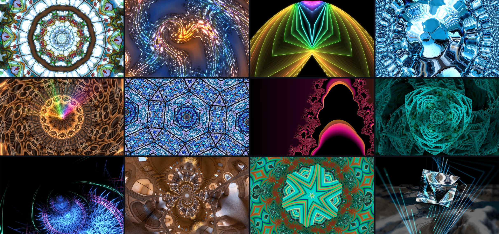
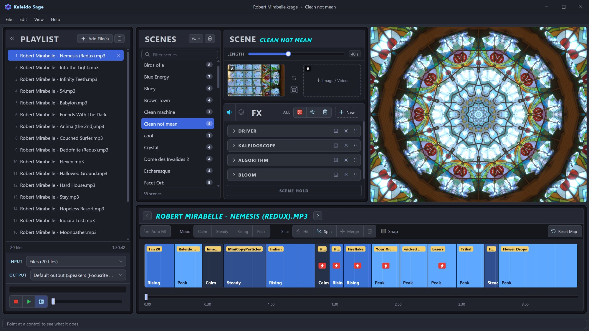
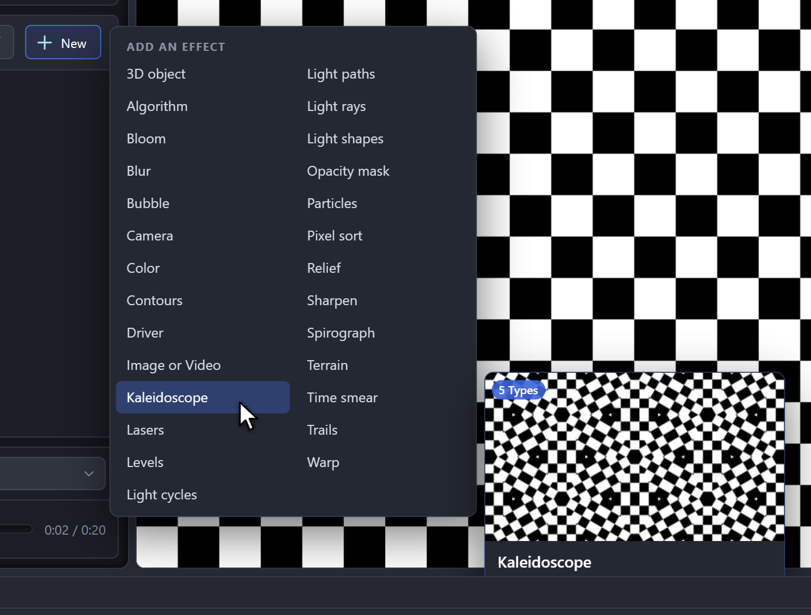
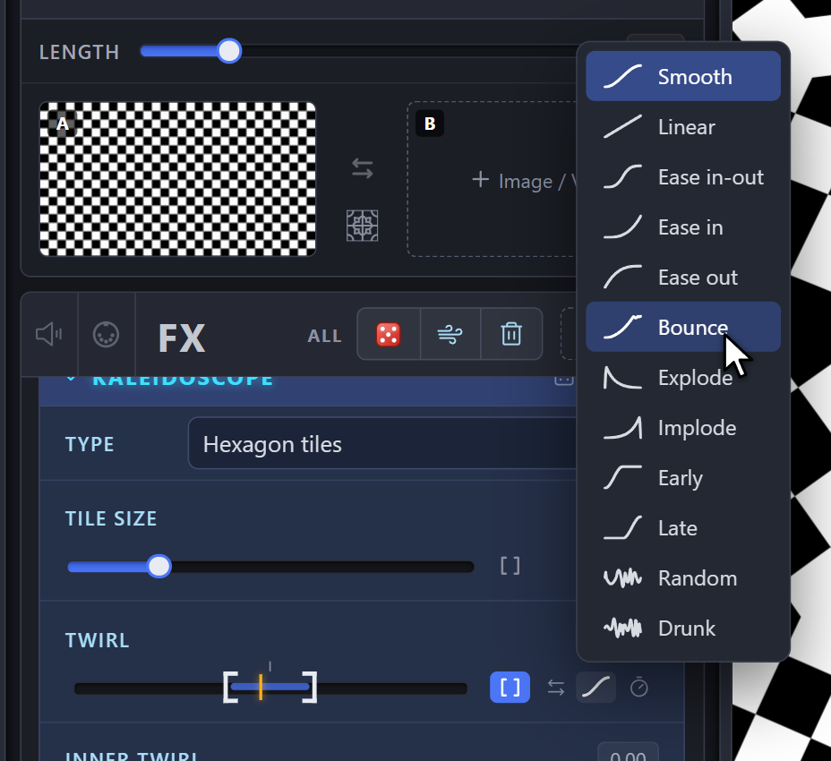
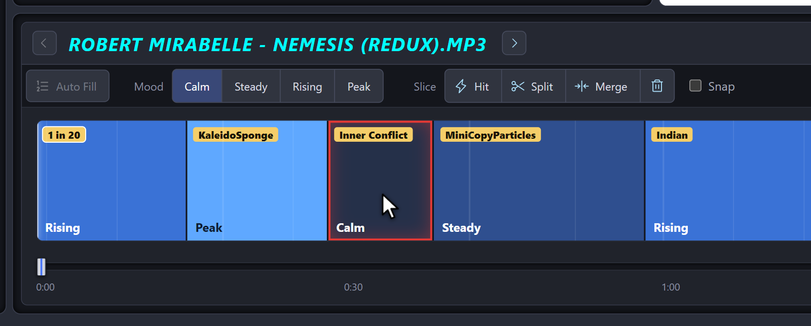
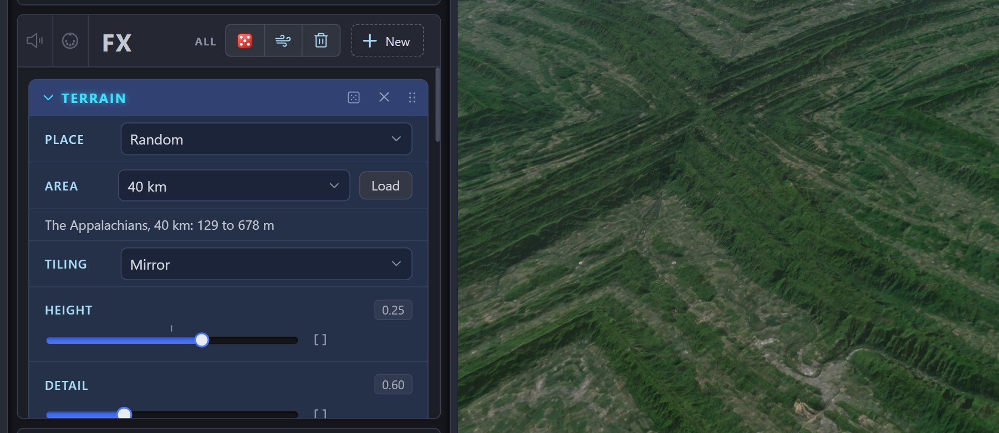
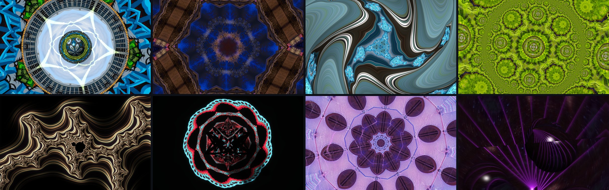

  

<h1 align="center">Kaleido Sage</h1>

<strong>Visual FX Playground</strong>

  Turn any image or video into moving visuals that follow your music. 
  Play them full screen, cast them to a projector, step inside them in VR, or export them as video.

  <a href="https://github.com/rmirabelle/kaleidosage/releases/latest"><strong>Download for Windows</strong></a>

  

<em>Each picture is one frame of a moving scene.</em>

---

## See it move

These music videos were made with Kaleido Sage. Each one is a show that follows its song, exported as one video.

<table>
  <tr>
    <td width="33%"></td>
    <td width="33%"></td>
    <td width="33%"></td>
  </tr>
  <tr>
    <td align="center"><a href="https://www.youtube.com/watch?v=E94S70F4jR0"><strong>▶ Infinity Teeth</strong></a></td>
    <td align="center"><a href="https://www.youtube.com/watch?v=u9XHnHR8ePQ"><strong>▶ Nemesis Redux</strong></a></td>
    <td align="center"><a href="https://www.youtube.com/watch?v=XF_wUA4zrSs"><strong>▶ Into the Light</strong></a></td>
  </tr>
</table>

## What it does

Kaleido Sage starts with one picture: a photo, a video or a pattern. You add effects, and they mirror it, bend it through fractals, fly a camera over it, or draw lines of light on it. Each setting of each effect can move by itself, or with the sound. A still photo becomes a picture that does not stop.

Then you collect your scenes in a project with your songs. Kaleido Sage examines each song, and changes the scene as the song goes from one part to the next. A full set of music plays as one show.

  

Use Kaleido Sage for:

- Visuals for a DJ set, a band or a party
- Music videos and looping clips for social media
- A moving picture on a second screen or a projector
- Free play with fractals, mirrors and light

## How it works

### 1. Stack effects

There are 31 effects, from Kaleidoscope and Mandelbrot to Lasers, Light cone, Particles, Spirograph, Text and real Terrain. Add them in any order. The picture goes through the list from top to bottom, so the order changes the result. Press `X` for new random settings, and lock the effects that you want to keep.

  

### 2. Make every setting move

Give a slider a range, and its value moves between two handles. Select how it moves: smooth, linear, with a bounce, at random, and more. Each range can follow the length of the scene or have its own time.

  

### 3. Let the music lead

Link a setting to the sound with one click. The app can listen to the sound of your PC, a microphone, or your own audio files. With audio files, Song Follow cuts each song into sections and shows them in the Song Map. You select the scene and the mood for each section, or let Auto Fill do it.

  

### 4. Show it

Play full screen, cast to a projector, a second screen or another PC on your network while the controls stay on your own screen, or see the picture on a large virtual screen in a Quest headset. Turn any setting with the knobs and faders of a MIDI controller. Export a scene as a seamless loop, or a song as a full music video.

## More than mirrors

The effects go far past a kaleidoscope. **Terrain** flies a camera over real land, with heights and satellite pictures from the internet. **3D object** puts your picture on a turning shape of glass or chrome. **3D model** shows a 3D model from a `.glb` file or from the free models of Poly Haven and Sketchfab, and the two share one space, so a model can go through a shape. **Light cycles**, **Lasers**, **Light cone**, **Light paths** and **Spirograph** draw with light, and **Particles** sends moving points of light out of the bright areas.

  

  

## Help in the app

Press `F1` for the built-in help: 16 chapters with pictures, from your first scene to a full show. The line at the bottom of the window explains the control under your mouse, and `?` shows every key and mouse gesture.

## System requirements

| | |
|---|---|
| **Operating system** | Windows 10 or Windows 11, 64-bit |
| **Graphics** | A graphics card with WebGL 2 support. A dedicated card gives the smoothest picture with many effects or on a large screen. |
| **Web engine** | Microsoft Edge WebView2 Runtime. Windows 11 includes it. The installer downloads it if it is missing. |

These items are optional:

| To use | You need |
|---|---|
| Random photos, photo search, Terrain, update checks, the first use of Song Follow | An internet connection |
| Live sound | Sound from your PC, a microphone or a line input |
| MIDI control | A MIDI controller |
| Cast | A second screen or a projector; or a second PC with Kaleido Sage on your network |
| Live VR | A Meta Quest with the Meta Quest Link app on the PC |

Kaleido Sage is for Windows only at this time.

## Installation

1. Go to the [latest release](https://github.com/rmirabelle/kaleidosage/releases/latest).
2. Download `KaleidoSage_<version>_x64-setup.exe`.
3. Run the file and follow the steps.

The installer is about 80 MB. It installs the app for your Windows user only, so you do not need administrator rights.

Windows can show "Windows protected your PC" because the installer has no code signature. To continue, click **More info**, then **Run anyway**.

### Updates

The app checks for a new version when it starts. You can also go to **Help > About** and click **Check for Updates**. When you click **Download and Install**, the app closes, installs the update and opens again. It asks about unsaved changes first.

### Uninstall

Go to **Windows Settings > Apps > Installed apps**, find **Kaleido Sage**, and click **Uninstall**.

## Your first scene

1. Click **New Project**.
2. Point at a source slot and pick a picture: **Random**, **Search**, **Open** or **Pattern**. You can also drop a file on the window or paste an image with `Ctrl+V`.
3. In the **FX** panel, click **New** and pick **Kaleidoscope**.
4. Click the range button on a setting. The value now moves between two handles.
5. In the play controls at the bottom of the left panel, open the **Input** menu and pick a sound source. Speakers then show beside the settings. Click a speaker, and that setting moves with the sound.
6. Press `F` to play full screen.

Press `X` at any time for new random settings on every unlocked effect. Press `?` to see every key and mouse gesture. The line at the bottom of the window explains the control under your mouse.

## Features

### Sources

- **Images:** PNG, JPEG, WebP, GIF, BMP and AVIF
- **Videos:** MP4, M4V, WebM, MOV and AVI. The video codec must be one that WebView2 can play. A video loops with a jump, with a crossfade of the length you set, or forward and then in reverse.
- **Random 4K photos** from Wikimedia Commons and NASA map imagery, with no account or key
- **Photo search** on Wikimedia Commons
- **Test patterns** that show what an effect does
- **Two slots**, A and B, with a crossfade between them

Photos from Wikimedia Commons have their own licenses. Check the license before you publish your work.

For the best result, use a picture at least 4K wide with many small, repeating details. Ceilings, domes, mosaics, stained glass and fractal art all work well.

### Effects

Add effects in any order. The picture goes through the list from top to bottom.

| Group | Effects |
|---|---|
| **Mirrors and math** | Kaleidoscope (radial, triangle, hexagon, square, hyperbolic, Penrose, sphere, pinwheel, mirror tunnel, fractal), Algorithm (Mandelbrot, Julia, Möbius, Droste spiral, log spiral, seamless spiral, tunnel, sine, power), Bubble (circle, square, radial) |
| **Motion and time** | Warp, Driver (caustics, smoke, ink, fire, ripples, video), Panorama, Trails, Time smear, Pixel sort |
| **3D** | 3D object (sphere, cube, morph, blobs, star, Menger sponge and more), 3D model (from a file, Poly Haven or Sketchfab), Terrain, Camera |
| **Light** | Bloom, Light rays, Lasers, Light cone (spotlight, laser shell; cone or pyramid), Light paths, Spirograph, Light shapes, Light cycles, Particles |
| **Line and surface** | Contours, Relief, Sharpen, Blur |
| **Color, text and layers** | Color, Levels, Opacity mask (brightness, radial, or a circle, triangle, square, hexagon or polygon shape), Image or Video (with a shape mask), Text (any installed font, glow, outline, shadow, scroll, type on) |

### Control every setting

- **Ranges:** Each value can move between two handles, with a choice of easing, direction and its own time.
- **Random and Nudge:** Get new settings for all effects or for one effect. Lock the effects that you want to keep.
- **Hold to compare:** Hold `Ctrl` on a name or an effect to turn it off for a moment.
- **Undo and redo** for your changes.

### Music

- **Three kinds of input:** the sound your PC plays (from any app), a microphone or line input, or audio files that the app plays
- **Audio files:** MP3, WAV, FLAC, OGG, Opus, M4A and AAC
- **Sound and beats:** Brightness and size follow the loudness and pulse on each beat. Sparkle follows the high sounds. Other settings move one step through their range on each beat. The app finds the beats by itself.
- **Master Gain and Master Threshold** set how much the sound moves the picture.
- **Output** sends the audio files to the speaker that you pick, for example a second sound card.

Windows cannot capture the sound of one app only. The PC input hears all sound on that output device.

### Song Follow

Add songs to the Playlist, and the app analyzes each song and cuts it into sections. The Song Map shows these sections as slices. **Auto Fill** picks a scene for each slice, and you can change any pick. The show then moves from scene to scene with the song.

The first time the app analyzes a song, it downloads the song analysis files, about 81 MB, and shows the progress in the Song Map. It does this only once. If you never use Song Follow, the app downloads nothing.

### MIDI

- Click **Learn**, move a knob or fader, then pick a setting.
- One control can move several settings, and one setting can have several controls.
- A knob on a range holds the value. The orange play button, or `Esc`, plays the range again.

### Show it

- **Full screen:** Press `F` or `F11`, or double-click the picture.
- **Scene changes:** Keys `1` to `9` select a scene with a crossfade, also in full screen.
- **Cast:** Press `C` to show the picture full screen on another screen. The main window stays free, and you can even minimize it. Cast and VR do not run at the same time.
- **Cast to another PC:** On a PC at a projector or a television, open Kaleido Sage and go to **View > Use This PC as a Receiver**. It then shows in the **View** menu of your own PC as **Cast to** with its name. The picture and the music of the Playlist go to it through your network; you need no other program.
- **Live VR:** Go to **View > Enter VR** to see the picture on a large virtual screen. Set the shape, width, distance and curve with the controllers. For setup, see [Set up live VR](#set-up-live-vr).

### Export

- **PNG:** Saves the picture as it is now, to `Pictures\Kaleido Sage` unless you pick another folder.
- **MP4 video:** The video is made in the background, and you can use the app while it runs.

| Video setting | Choices |
|---|---|
| **Size** | Screen shape, 16:9 (YouTube), 9:16 (TikTok, Reels, Shorts), 1:1 and 4:5 (Instagram), 360° (VR headsets) |
| **Scenes** | The scene on the screen, all scenes (one file each, or one video with crossfades), or a song |
| **Length** | One, two or three loops of the scene |
| **Style** | Seamless loop, or a title at the start |
| **Quality** | Standard, High or Best |
| **Frame rate** | 30 or 60 frames per second |

A video of a scene plays the ranges. Audio links do not move the picture in it, and it has no sound. A **Song** video is different: it follows the song as the show does, with its scenes and its sound, so it is a complete music video.

### Projects

A project (`.ksage`) holds your scenes in order and your audio settings. When the input is Files, it also holds the audio files. A project plays the same on another PC.

You can import scenes from other projects, and export one scene as its own project.

## Set up live VR

1. Install the Meta Quest Link app on your PC and sign in.
2. In the app, go to **Settings > General** and set Meta Quest Link as the active OpenXR runtime.
3. Connect the headset with a USB 3 cable or Air Link.
4. In the headset, open **Quick Settings > Quest Link > Launch**.
5. In Kaleido Sage, go to **View > Enter VR**.

To exit, press `Esc` or use the headset's menu.

| Controller | Action |
|---|---|
| Right stick forward or back | Move the screen away or near |
| Right stick right or left | Make the screen wider or narrower |
| Left stick forward or back | More or less curve |
| A | Next screen shape |
| B | Reset the screen |
| Hold the Meta button | Bring the screen in front of you |

## Keyboard shortcuts

| Key | Action |
|---|---|
| `Space` | Play or pause the scene |
| `Shift+Space` | Stop the scene and go back to its start |
| `F` or `F11` | Full screen |
| `Esc` | Leave full screen |
| `C` | Cast to another screen or another PC, or stop |
| `1` to `9` | Select a scene tab, with a crossfade |
| `X` | Random settings for all unlocked effects |
| `H` | Hide or show the panels |
| `A` | Audio panel |
| `M` | MIDI panel |
| `P` | Show or hide performance numbers |
| `F1` | Help |
| `Ctrl+N` | Add a blank scene |
| `Ctrl+O` | Open a project |
| `Ctrl+S` | Save the project |
| `Ctrl+Z` / `Ctrl+Y` | Undo / redo |
| `Ctrl+V` | Use the image on the clipboard |
| `?` | Show all shortcuts and gestures |

## Privacy

Kaleido Sage has no account and no ads. It connects to the internet only to:

- Check for updates and download them (GitHub)
- Get random and searched photos (Wikimedia Commons, NASA)
- Get land and satellite data for the Terrain effect (Amazon Web Services, NASA)
- Download the song analysis files, the first time you use Song Follow (GitHub, Hugging Face)

Sound capture stays on your PC. The app does not send your sound, pictures or projects anywhere.

## Credits

Kaleido Sage is by Robert Mirabelle.

Song Follow uses these models:

- **Beat This!** by F. Foscarin, J. Schlüter and G. Widmer (MIT license; Rust port by danigb)
- **LinkSeg** by M. Buisson, B. McFee and S. Essid (model weights under [CC BY 4.0](https://creativecommons.org/licenses/by/4.0/); ONNX port by linkseg-web, MIT license)
